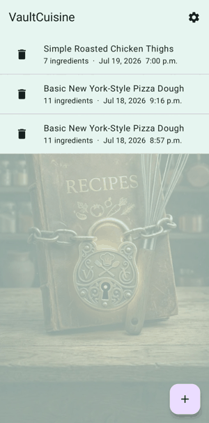

<!DOCTYPE html>
<html lang="en">
<head>
  <meta charset="UTF-8" />
  <meta name="viewport" content="width=device-width, initial-scale=1.0" />
  <title>VaultCuisine</title>
  
</head>
<body>
  <main class="container">
    <h1>VaultCuisine</h1>

    

      
    

    

      An Android application that converts printed and handwritten recipe cards into editable, structured data. Text recognition runs locally on device by default. Cloud AI structuring is opt-in, requires a user-provided API key, and transmits compressed, EXIF-stripped images only after explicit consent.
    

    <h2>Closed Testing on Google Play</h2>
    

      VaultCuisine has moved into the Closed Testing phase on the Google Play Store. Follow these steps to join the early beta testers and try it out:
    

    

      

        

          Step 1
          <h3>Join the Google Group</h3>
          
Join the tester group first so your Google account is eligible for closed testing.

        

        <a class="beta-btn btn-blue" href="https://groups.google.com/d/forum/vaultcuisine" target="_blank" rel="noopener">Join Google Group &rarr;</a>
      

      

        

          Step 2
          <h3>Become a Tester</h3>
          
Opt in on the web using the same Google account you used to join the group.

        

        <a class="beta-btn btn-green" href="https://play.google.com/apps/testing/com.rekluzlabs.vaultcuisine" target="_blank" rel="noopener">Become a Tester &rarr;</a>
      

      

        

          Step 3
          <h3>Install on Android</h3>
          
Open the Play Store listing on Android. <em>It can take up to 30 minutes to become available.</em>

        

        <a class="beta-btn btn-teal" href="https://play.google.com/store/apps/details?id=com.rekluzlabs.vaultcuisine" target="_blank" rel="noopener">Install from Play Store &rarr;</a>
      

    

    <h2>Core features</h2>
    <ul>
      <li><strong>On-device text recognition:</strong> Uses ML Kit OCR locally. Executes offline on supported devices without network calls.</li>
      <li><strong>Opt-in cloud AI structuring:</strong> Connects to the Google Gemini API using a user-provided API key. Converts OCR text and images into structured fields including title, ingredients, instructions, and timers. Gated by a consent dialog prior to network transmission.</li>
      <li><strong>Offline heuristic fallback:</strong> Uses regular expression parsing when no API key is configured or when the user declines the cloud consent prompt.</li>
      <li><strong>Inline recipe editing:</strong> Supports editing text lines, adding or removing ingredient and instruction entries, and reordering items via drag-and-drop or a long-press menu.</li>
      <li><strong>Original photo rescan:</strong> Re-runs AI structuring against the original stored photo without modifying existing edits until explicitly saved.</li>
      <li><strong>Manual retry control:</strong> Provides a retry control on the review screen to resend the photo for another pass or retake the image.</li>
      <li><strong>Scaling and unit conversions:</strong> Scales serving sizes and converts between metric and imperial units per recipe upon explicit request.</li>
      <li><strong>Local metadata:</strong> Stores chef-written notes and star ratings locally on device.</li>
    </ul>

    <h2>Processing architecture</h2>
    <pre><code>Photo ──&gt; ML Kit OCR (On-device, local) ──&gt; Structuring engine
                                                 │
                                                 ├─ API key set + Consent granted
                                                 │  └─&gt; Gemini API (Cloud)
                                                 │
                                                 └─ No key OR Consent declined
                                                    └─&gt; Regex parser (Local)
                                                         │
                                                         ▼
                                                Editable review screen
                                                         │
                                                         ▼
                                                Local Room database</code></pre>
    
Scans present an editable review screen prior to saving to local storage.

    <h2>App preview</h2>
    

      
    

    <h2>Tech stack</h2>
    <ul>
      <li><strong>Language and UI:</strong> Kotlin, Jetpack Compose</li>
      <li><strong>Local persistence:</strong> Room database</li>
      <li><strong>On-device OCR:</strong> ML Kit Text Recognition v2</li>
      <li><strong>Cloud AI:</strong> Google Gemini API via user-provided API key</li>
      <li><strong>Key security:</strong> EncryptedSharedPreferences (transmits only to Google API endpoints for authentication)</li>
      <li><strong>Fallback engine:</strong> Kotlin regular expression parser</li>
    </ul>

    <h2>Requirements</h2>
    <ul>
      <li>Android 8.0 or higher (API level 26)</li>
      <li>Optional: Google Gemini API key from ai.google.dev for cloud AI structuring. Scanning and heuristic parsing function without an API key.</li>
    </ul>

    <h2>Project status and limitations</h2>
    
VaultCuisine is in early alpha testing. Current technical limitations include:

    <ul>
      <li><strong>Handwriting recognition:</strong> Accuracy varies based on card legibility. Mitigations include image contrast adjustments, JSON schema constraints on Gemini responses, and confidence-triggered retries.</li>
      <li><strong>Database migrations:</strong> The app uses destructive migration (<code>fallbackToDestructiveMigration</code>). Schema updates clear local database tables during alpha testing.</li>
      <li><strong>Pending release blockers:</strong> Live testing across target handwritten cards and replacing destructive migrations with explicit migration scripts.</li>
    </ul>

    <h2>Planned development</h2>
    <ul>
      <li>Implement explicit Room database migration scripts prior to public release.</li>
      <li>Add confidence-level visual indicators on the review screen interface.</li>
      <li>Add recipe export and print options.</li>
      <li>Add meal planning and pantry inventory tools.</li>
    </ul>

    <h2>Privacy practices</h2>
    <ul>
      <li>VaultCuisine collects no analytics and contains no advertisements, in-app purchases, or subscription code.</li>
      <li>On-device OCR processes image frames locally without network requests.</li>
      <li>Cloud processing runs only when an API key is present and the consent dialog is confirmed.</li>
      <li>Cloud requests strip EXIF metadata from uploaded images. Uploads route directly to Google API endpoints without intermediate servers.</li>
      <li>API keys are stored using <code>EncryptedSharedPreferences</code>.</li>
      <li>Review <code>PRIVACY.md</code> for complete data handling details.</li>
    </ul>

    <h2>License</h2>
    
All Rights Reserved. See <a href="LICENSE.md">LICENSE.md</a> for details.

  </main>
</body>
</html>
